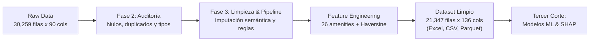

# 🗽 Modelo Predictivo y de Inteligencia de Mercado (Inside Airbnb NYC)
## Proyecto de Ciencia de Datos - X Semestre
**Metodología:** CRISP-DM | **Autores:** Jair Yara & Catherinne Gutiérrez  
**Repositorio Oficial:** [https://github.com/jairyara/data-science](https://github.com/jairyara/data-science)  
**Documento Fundacional:** [Project Charter V0.1](plantilla_project_charter_v0_1.md) | [Hoja de Ruta Metodológica](RECOMENDACIONES_ROADMAP.md)

---

## 🎯 Entrega Oficial - Segundo Corte: Fases 2 y 3 (CRISP-DM)
Este repositorio consolida el desarrollo formal de las fases de **Comprensión de Datos (*Data Understanding*)** y **Preparación de Datos (*Data Preparation*)**, integrando las técnicas de auditoría y calidad vistas en las sesiones de clase con el pipeline de ingeniería de características para el caso de estudio de **Inside Airbnb (New York City)**.



---

## 🧭 Mapa de Navegación de Entregables (Segundo Corte)

### 1. 📑 Informes Técnicos Ejecutivos (`reports/segundo_corte/`)
Informes analíticos en formato Markdown con el desglose metodológico completo y justificación teórica:

| Informe | Descripción y Contenido Clave |
| :--- | :--- |
| **[01. Auditoría de Calidad y Perfilado](reports/segundo_corte/01_reporte_auditoria_calidad.md)** | Diagnóstico estructural de las 30,259 filas y 90 columnas; identificación de 12 columnas 100% vacías, descarte de 8,744 filas sin variable objetivo (`price`), análisis de nulos por tipología y auditoría de tipos corruptos. |
| **[02. Estrategia de Limpieza y Transformación](reports/segundo_corte/02_estrategia_limpieza_y_transformacion.md)** | Reglas aplicadas de exclusión justificada ($10-$2,000 USD/noche, estancias ≤ 365 días), imputación semántica ($\lceil\text{accommodates}/2\rceil$), binarización de 26 comodidades clave y cálculo de distancias Haversine a hitos de NYC. |
| **[03. Análisis EDA y Respuestas de Negocio](reports/segundo_corte/03_analisis_eda_y_hallazgos_negocio.md)** | Respuestas cuantitativas a las 5 preguntas analíticas del *Project Charter* con estadísticas bivariadas, correlaciones y primas de valor por tipología, comodidades y localización. |
| **[README de Entrega](reports/segundo_corte/README.md)** | Resumen ejecutivo, estructura de carpetas y guía de continuidad para el Tercer Corte. |

### 2. 📓 Cuadernos Ejecutables Oficiales (`notebooks/segundo_corte/`)
Notebooks de Jupyter con celdas ejecutadas, salidas renderizadas y trazabilidad completa:

* **[`01_auditoria_calidad_airbnb.ipynb`](notebooks/segundo_corte/01_auditoria_calidad_airbnb.ipynb):** Aplicación de técnicas de clase sobre el dataset crudo (filas vacías, incompletas por umbral, duplicados e inspección de distribuciones).
* **[`02_limpieza_transformacion_pipeline.ipynb`](notebooks/segundo_corte/02_limpieza_transformacion_pipeline.ipynb):** Construcción modular paso a paso del pipeline de transformación y exportación en múltiples formatos.
* **[`03_eda_bivariado_y_preguntas_negocio.ipynb`](notebooks/segundo_corte/03_eda_bivariado_y_preguntas_negocio.ipynb):** Análisis exploratorio bivariado, distribuciones de tarifas, matrices de correlación y visualización de preguntas de negocio.

### 3. 📊 Dataset Limpio y Procesado (`data/selected/airbnb/processed/segundo_corte/`)
El dataset depurado y enriquecido está disponible en tres formatos para facilitar su revisión y posterior consumo:

* **[`airbnb_nyc_limpio.xlsx`](data/selected/airbnb/processed/segundo_corte/airbnb_nyc_limpio.xlsx)** (25 MB): Formato nativo en **Microsoft Excel** con filtros automáticos, ideal para inspección visual directa en **Microsoft Teams** o suites ofimáticas.
* **[`airbnb_nyc_limpio.csv`](data/selected/airbnb/processed/segundo_corte/airbnb_nyc_limpio.csv)** (64 MB): Formato tabular plano estándar.
* **[`airbnb_nyc_limpio.parquet`](data/selected/airbnb/processed/segundo_corte/airbnb_nyc_limpio.parquet)** (15 MB): Formato binario columnar optimizado para carga rápida en modelos de Machine Learning (Tercer Corte).

### 4. 📝 Talleres y Bitácoras Prácticas de Clase (`notebooks/bitacoras_clase/`)
Evidencia de la aplicación práctica de los talleres guiados en las sesiones de clase:
* **`exploracion.ipynb` y `transformacion.ipynb`**: Análisis exploratorio y transformaciones sobre los ejercicios de aula.
* **Hojas de cálculo de validación**: `sin_vacios.xlsx`, `sin_imcompletos.xlsx`, `sin_duplicados.xlsx`, `relleno.xlsx`.
* **Copia de seguridad original**: [`BASE_DATOS_VIVEROS_MAYO_2026_ORIGINAL.xlsx`](data/backup/BASE_DATOS_VIVEROS_MAYO_2026_ORIGINAL.xlsx) preservada en `data/backup/`.

---

## ⚖️ Balance de Calidad: Antes vs. Después de la Preparación

| Dimensión / Criterio | Estado Crudo (*Raw*) | Estado Procesado (*Segundo Corte*) | Impacto Metodológico |
| :--- | :---: | :---: | :--- |
| **Volumetría (Filas)** | 30,259 | **21,347** | Depuración de listados sin precio objetivo y valores aberrantes. |
| **Dimensiones (Columnas)** | 90 | **136** | Descarte de 12 cols vacías + incorporación de 58 variables derivadas. |
| **Variable Objetivo (`price`)** | 8,744 nulos (28.9%) + strings (`"$150.00"`) | **0 nulos** (`price_usd` en `float64`) | Estandarizada y acotada al rango realista [$10, $2000 USD/noche]. |
| **Infraestructura (`bedrooms`/`beds`)** | ~33% valores ausentes | **0 nulos** | Imputación semántica por capacidad física: $\lceil\text{accommodates}/2\rceil$. |
| **Baños (`bathrooms_text`)** | Strings heterogéneos (`"1.5 baths"`, `"Half-bath"`) | **0 nulos** (`bathrooms_num` en `float64`) | Conversión numérica continua estandarizada. |
| **Comodidades (`amenities`)** | Strings anidados en JSON crudo | **26 columnas binarias** (`has_wifi`, `has_ac`, etc.) | *One-hot encoding* de facilidades de alto valor explicativo. |
| **Geolocalización** | Coordenadas puras (`latitude`, `longitude`) | **4 distancias geodésicas** | Distancia Haversine (km) a Times Square, Central Park, Financial Dist y Brooklyn Bridge. |
| **Condición de Anfitrión** | Cadenas de texto `'t'` / `'f'` | **Variables binarias** (1 / 0) | `host_is_superhost`, `host_identity_verified`, etc. |

---

## 💡 Hallazgos Clave del Negocio (Resumen Ejecutivo)

1. **Tipología de Alojamiento como Factor Determinante:**
   * La tarifa mediana de un apartamento completo (*Entire home/apt*) se sitúa en **\$225 USD/noche**, frente a **\$95 USD/noche** en habitación privada (*Private room*) y **\$60 USD/noche** en habitación compartida.
2. **Retorno de Inversión en Comodidades (*Amenities ROI*):**
   * **Servicios de Teletrabajo y Confort Diario:** El aire acondicionado (+33.3%, \$180 vs \$135 USD) y el espacio de trabajo dedicado (*Dedicated workspace*, +22.6%, \$190 vs \$155 USD) ofrecen el mayor beneficio marginal relativo para un anfitrión con una baja inversión de capital.
   * **Atributos de Lujo:** Piscina (+62.8%), Jacuzzi (+45.3%) y Gimnasio (+41.2%) dominan los sobreprecios del segmento exclusivo.
3. **Gradiente Geográfico y Densidad Turística:**
   * Manhattan ostenta la tarifa mediana más alta (**\$200 USD/noche**), seguida de Brooklyn (**\$135 USD/noche**), Queens (**\$100 USD/noche**), Staten Island (**\$100 USD/noche**) y The Bronx (**\$90 USD/noche**).
   * La distancia geodésica a Times Square muestra una correlación negativa moderada ($r = -0.32$), duplicando las tarifas para propiedades ubicadas a menos de 3 km del núcleo turístico.
4. **Efecto de la Condición de *Superhost*:**
   * Los listados gestionados por Superhosts alcanzan una prima de precio mediana del **+10.5%** (\$158 vs \$143 USD) y presentan una dispersión de calificaciones significativamente menor.

---

## 🗂️ Arquitectura del Repositorio

```
data-science/
├── plantilla_project_charter_v0_1.md       # Project Charter formal del proyecto
├── RECOMENDACIONES_ROADMAP.md              # Hoja de ruta metodológica y plan de 6 fases
├── README.md                               # Este archivo (Landing principal)
├── requirements.txt                        # Dependencias de Python del proyecto
├── data/
│   ├── backup/                             # Respaldo del dataset original de clase (Viveros)
│   │   └── BASE_DATOS_VIVEROS_MAYO_2026_ORIGINAL.xlsx
│   ├── evaluation/                         # Datasets evaluados como respaldo (Olist, LendingClub)
│   └── selected/airbnb/                    # Dataset seleccionado de desarrollo
│       ├── raw/nyc/                        # Datos crudos de Inside Airbnb NYC (listings.csv.gz)
│       └── processed/segundo_corte/        # DATASETS LIMPIOS Y EXPORTADOS
│           ├── airbnb_nyc_limpio.xlsx      # Dataset limpio en Excel (25 MB)
│           ├── airbnb_nyc_limpio.csv       # Dataset limpio en CSV (64 MB)
│           └── airbnb_nyc_limpio.parquet   # Dataset limpio en Parquet para ML (15 MB)
├── notebooks/
│   ├── bitacoras_clase/                    # Bitácoras y talleres prácticos de clase
│   └── segundo_corte/                      # NOTEBOOKS EJECUTABLES OFICIALES
│       ├── 01_auditoria_calidad_airbnb.ipynb       # Fase 2: Auditoría, nulos y técnicas de clase
│       ├── 02_limpieza_transformacion_pipeline.ipynb # Fase 3: Pipeline de limpieza y exportación
│       └── 03_eda_bivariado_y_preguntas_negocio.ipynb# Fase 3: EDA bivariado y 5 preguntas de negocio
├── reports/
│   └── segundo_corte/                      # INFORMES TÉCNICOS EN MARKDOWN
│       ├── README.md                       # Índice y guía de la entrega
│       ├── 01_reporte_auditoria_calidad.md         # Diagnóstico de integridad y nulos
│       ├── 02_estrategia_limpieza_y_transformacion.md # Justificación de reglas y feature engineering
│       └── 03_analisis_eda_y_hallazgos_negocio.md  # Respuestas con datos a preguntas de negocio
└── src/                                    # Código modular reutilizable en Python
    ├── __init__.py
    ├── data_loader.py                      # Descarga y carga eficiente de datasets
    ├── cleaning.py                         # Funciones modulares de auditoría, nulos y limpieza
    ├── features.py                         # Extracción de comodidades y distancias Haversine
    └── models.py                           # Arquitectura para entrenamiento y métricas (Tercer Corte)
```

---

## 🚀 Hoja de Ruta: Hacia el Tercer Corte (Machine Learning)

El pipeline de preparación entrega el archivo `airbnb_nyc_limpio.parquet` completamente estandarizado, habilitando de forma directa el inicio del **Tercer Corte**:

1. **Partición Estratificada Train/Validation/Test** para evitar fuga de información (*data leakage*).
2. **Entrenamiento de Modelos Predictivos:** Regresión Lineal Ridge/Lasso, Random Forest Regressor, **LightGBM** y **XGBoost**.
3. **Ajuste de Hiperparámetros:** Optimización Bayesiana orientada a minimizar el *MAE* y *MedAE*.
4. **Explicabilidad Global y Local (XAI):** Cálculo de valores **SHAP** (*SHapley Additive exPlanations*) para auditar el impacto directo de cada variable sobre las tarifas.
