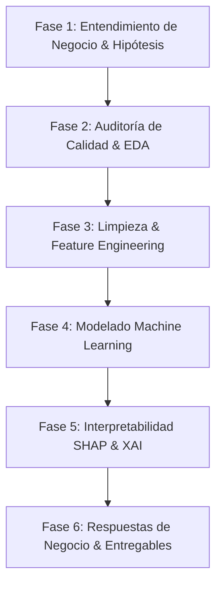

# Proyecto de Ciencia de Datos - X Semestre
## Guía Metodológica, Selección de Datasets y Roadmap de Trabajo

Este documento consolida la arquitectura de datos, el análisis de los datasets evaluados, la metodología de trabajo (**CRISP-DM**) y la formulación de preguntas de negocio para el proyecto.

---

## 1. Estructura de Datasets del Proyecto

El repositorio organiza los datos en dos niveles: el dataset principal de desarrollo y los datasets de evaluación/respaldo.

```
data/
├── selected/
│   └── airbnb/                  <-- DATASET PRINCIPAL ELEGIDO (Inside Airbnb)
│       └── README.md
└── evaluation/
    ├── olist/                   <-- DATASET EN EVALUACIÓN (E-Commerce Brasil)
    │   └── README.md
    └── lending_club/            <-- DATASET EN EVALUACIÓN (FinTech & Riesgo Crediticio)
        └── README.md
```

---

## 2. Detalle de los Datasets

### 🌟 Dataset Seleccionado: **Inside Airbnb Listings & Reviews**
* **Ubicación en repo**: `data/selected/airbnb/`
* **Dominio**: Turismo, Real Estate & Optimización de Precios.
* **Volumen**: Cientos de miles de alojamientos por ciudad (ej. NYC, Madrid, Londres) + millones de registros en calendario y reseñas.
* **Tablas / Archivos Clave**:
  1. `listings.csv.gz` (Detallado con +75 columnas: descripciones, anfitriones, precios, comodidades, políticas).
  2. `calendar.csv.gz` (Ocupación diaria, disponibilidad futura y variación de precios por fecha).
  3. `reviews.csv.gz` (Texto completo de reseñas, fechas y usuarios).
  4. `neighbourhoods.geojson` (Polígonos geoespaciales para análisis geográfico).

#### ¿Por qué es un dataset no limpio / no normalizado?
1. **Tipos de datos corruptos**: Precios y depósitos almacenados como strings con formato de moneda (`"$1,250.00"`).
2. **Estructuras anidadas en strings**: La columna `amenities` viene como listas de texto en formato JSON crudo o strings escapados (`'["Wifi", "Air conditioning", "\"Dedicated workspace\""]'`).
3. **Texto no estructurado rico**: Campos de texto libre (`name`, `description`, `neighborhood_overview`, `host_about`) con múltiples idiomas, caracteres especiales y faltas ortográficas.
4. **Valores atípicos extremos**: Alojamientos con precios de $0 o $99,999 la noche, requisitos de estancia mínima de 1,000 días, etc.
5. **Nulos con significado de negocio**: `review_scores_rating` es nulo para propiedades nuevas sin reseñas; `host_response_time` es nulo para anfitriones inactivos.

#### Potencial de Modelado en Ciencia de Datos
* **Regresión (Machine Learning Supervisado)**:
  * Predicción del precio óptimo por noche (*Dynamic Pricing*).
  * Estimación del ingreso mensual proyectado por propiedad.
* **Clasificación**:
  * Detección de probabilidad de ser *Superhost*.
  * Clasificación de alta ocupación vs. baja ocupación.
* **NLP & Minería de Texto**:
  * Extracción de tópicos y sentimiento en reseñas para predecir cancelaciones o quejas.
  * Análisis de valor de palabras clave en la descripción del inmueble.
* **Clustering & Geo-analítica**:
  * Agrupación de micro-zonas turísticas basada en precio, comodidades y densidad geográfica.

---

### 📦 Datasets en Carpeta de Evaluación (Respaldo)

#### 1. Olist Brazilian E-Commerce (`data/evaluation/olist/`)
* **Dominio**: Retail, Logística y Experiencia de Usuario.
* **Volumen**: ~100,000 órdenes en 9 tablas relacionales.
* **Desafíos de Calidad**: Cruces relacionales complejos, fechas de entrega que requieren parsing temporal estricto, reseñas con lenguaje informal en portugués, ruido en coordenadas de geolocalización.
* **Aplicación**: Predicción de retrasos de entrega, segmentación RFM, análisis de sentimiento de quejas.

#### 2. LendingClub Loan Data (`data/evaluation/lending_club/`)
* **Dominio**: Banca, FinTech y Riesgo Crediticio.
* **Volumen**: +1M de registros, +100 variables.
* **Desafíos de Calidad**: Fuerte desbalance de clases (Default vs Paid), data leakage por variables post-otorgamiento de crédito, strings numéricos (`"12.5%"`), nulos sistemáticos.
* **Aplicación**: Probabilidad de default (Scoring crediticio), optimización de tasa de interés, análisis de supervivencia.

---

## 3. Plan Metodológico de Trabajo (CRISP-DM)



### Fase 1: Entendimiento del Negocio y Planteamiento de Hipótesis
* Definición de objetivos de negocio claros (KPIs a optimizar).
* Formulación de preguntas de investigación e hipótesis falsables.
* Definición de la variable objetivo (*target*) y métricas de evaluación técnica (RMSE, MAE, R², F1-Score, PR-AUC).

### Fase 2: Auditoría de Calidad y EDA (Exploratory Data Analysis)
* Perfilado de datos (*Data Profiling*): tipos de datos, cardinalidad, distribución de nulos.
* Detección y tratamiento justificado de valores atípicos (*outliers*).
* Análisis univariado, bivariado y multivariado (correlaciones, distribución espacial).

### Fase 3: Limpieza, Normalización e Ingeniería de Características
* **Pipeline de transformación reproducible** con `scikit-learn` / `ColumnTransformer`.
* Limpieza y parseo de tipos de datos (moneda a `float`, fechas a `datetime`, listas de `amenities` a *One-Hot/Multi-Label Binarizer*).
* Creación de nuevas características de valor (*Feature Engineering*):
  * Distancia al centro de la ciudad o puntos de interés (Haversine).
  * Antigüedad del anfitrión y ratios de disponibilidad (`availability_30 / 30`).
  * Conteo de comodidades premium (aire acondicionado, piscina, parking).
* Normalización / estandarización según el modelo (Robusta, MinMax, StandardScaler).

### Fase 4: Modelado Predictivo & Machine Learning
* Partición de datos estratificada / temporal evitando *data leakage*.
* Modelos de referencia (*Baselines*): Dummy, Regresión Lineal Regularizada (Ridge/Lasso).
* Modelos avanzados basados en árboles: **LightGBM**, **XGBoost**, **CatBoost**, **Random Forest**.
* Validación Cruzada K-Fold / TimeSeriesSplit.
* Optimización de hiperparámetros con **Optuna** o búsqueda Bayesiana.

### Fase 5: Interpretabilidad (XAI) y Traducción a Negocio
* Explicabilidad global y local con valores **SHAP** (*SHapley Additive exPlanations*).
* Análisis de dependencia parcial (*Partial Dependence Plots*).
* Matriz de impacto económico / costo-beneficio de las decisiones derivadas del modelo.

### Fase 6: Respuestas a Preguntas de Negocio y Reporte Final
* Respuesta explícita a cada pregunta planteada en la Fase 1 respaldada por evidencia estadística y modelos.
* Recomendaciones estratégicas para *stakeholders* (ej. anfitriones, inversionistas o plataformas turísticas).
* Estructuración del repositorio y notebooks ejecutables.

---

## 4. Preguntas de Negocio Guía para Inside Airbnb

Al finalizar el ejercicio, responderemos cuantitativa y cualitativamente:

1. **Optimización de Ingresos & Precios**:
   * ¿Cuál es el precio base recomendado para una nueva propiedad en función de su ubicación, capacidad y comodidades?
   * ¿Qué comodidades (*amenities*) generan el mayor incremento marginal en el precio por noche?
2. **Factores de Éxito del Anfitrión**:
   * ¿Qué características operativas diferencian a un *Superhost* de un anfitrión estándar (tiempo de respuesta, políticas de cancelación, volumen de reseñas)?
3. **Dinámica de Ocupación y Demanda**:
   * ¿Qué variables geográficas o estacionales explican las tasas de ocupación más altas dentro de la ciudad?
4. **Sensibilidad y Percepción del Huésped**:
   * ¿Cómo influyen el precio y las reglas de estancia mínima en la calificación promedio de las reseñas?
