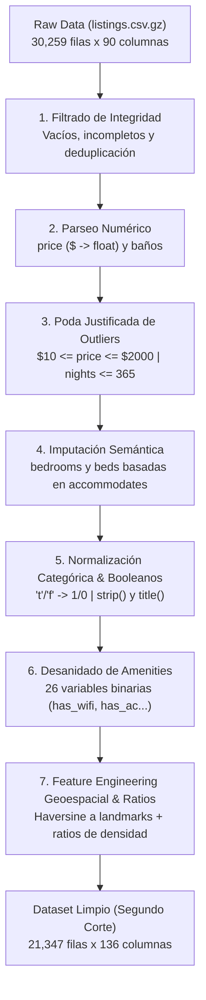

# 🧹 Reporte 2: Estrategia de Limpieza, Transformación e Ingeniería de Características
## Proyecto de Ciencia de Datos (X Semestre) - Segundo Corte
### Caso de Estudio: Inside Airbnb (New York City)

---

## 1. Alcance y Objetivos de la Fase de Preparación de Datos

La **Fase 3 (Data Preparation)** de la metodología **CRISP-DM** tiene como propósito convertir los datos crudos, inconsistentes y no estructurados en un conjunto de datos tabular, homogéneo, libre de valores ausentes en variables clave y enriquecido con variables derivadas de alto valor explicativo.

El proceso se ejecutó de forma reproducible a través de [`src/cleaning.py`](file:///Users/jyarar/projects/u/x-semestre/data-science/src/cleaning.py), [`src/features.py`](file:///Users/jyarar/projects/u/x-semestre/data-science/src/features.py) y el cuaderno oficial [02_limpieza_transformacion_pipeline.ipynb](file:///Users/jyarar/projects/u/x-semestre/data-science/notebooks/segundo_corte/02_limpieza_transformacion_pipeline.ipynb).

---

## 2. Pipeline de Limpieza Paso a Paso

### Paso 1: Purgado de Filas Vacías e Incompletas (Técnicas de Clase)
* **Función:** [`drop_empty_rows()`](file:///Users/jyarar/projects/u/x-semestre/data-science/src/cleaning.py) y [`filter_incomplete_rows(min_valid_cols=15)`](file:///Users/jyarar/projects/u/x-semestre/data-science/src/cleaning.py).
* **Justificación:** Garantiza que no se procesen filas corruptas originadas por saltos de línea irregulares en el archivo comprimido.
* **Resultado:** Se validó la presencia de más de 15 columnas con datos en todos los registros.

### Paso 2: Auditoría y Remoción de Duplicados
* **Función:** [`remove_duplicates(subset=['id'])`](file:///Users/jyarar/projects/u/x-semestre/data-science/src/cleaning.py).
* **Justificación:** En plataformas colaborativas pueden existir duplicados accidentales generados por sincronización de anuncios. Se confirmó que cada fila representa un `id` único.

### Paso 3: Parseo Numérico de Precios y Baños
* **`price` a `price_usd`:** Extracción mediante expresión regular eliminando signos monetarios (`$`) y comas de miles.
* **`bathrooms_text` a `bathrooms_num`:**
  * Valores mixtos como `"1 bath"`, `"1.5 baths"` se convierten a su escalar correspondiente ($1.0, 1.5$).
  * Expresiones descriptivas como `"Half-bath"` o `"Shared half-bath"` se mapean a $0.5$.
  * Valores nulos remanentes se imputan con $1.0$ (estándar mínimo de salubridad e higiene).

### Paso 4: Tratamiento Justificado de Valores Atípicos (*Outliers*)
* **Tarifas diarias irreales:** Se acotó el rango a **[\$10.00 USD, \$2,000.00 USD/noche]**. Se eliminaron listados con precio \$0.00 USD (anuncios ficticios) y propiedades con precios de cientos de miles de dólares usadas como bloqueo temporal.
* **Estancias mínimas aberrantes:** Se filtraron registros con `minimum_nights > 365 días` (errores de entrada). Se preservaron las estancias válidas de 30 a 365 días representativas de la regulación **Local Law 18**.

### Paso 5: Imputación Semántica de Capacidad e Infraestructura
* **Regla de negocio:** No es realista imputar la media global de cuartos o camas a un apartamento estudio. En su lugar, se utilizó la variable de capacidad máxima declarada `accommodates`:
  $$\text{bedrooms\_num} = \begin{cases} \text{bedrooms} & \text{si no es nulo} \\ \lceil \text{accommodates} / 2 \rceil & \text{si es nulo} \end{cases}$$
  $$\text{beds\_num} = \begin{cases} \text{beds} & \text{si no es nulo} \\ \text{bedrooms\_num} & \text{si es nulo} \end{cases}$$
* **Resultado:** Se resolvieron los más de 10,000 valores ausentes en dormitorios y camas de manera proporcional a la capacidad de cada inmueble.

### Paso 6: Normalización Categórica y Conversión Booleana
* **Variables booleanas textuales:** `host_is_superhost`, `host_has_profile_pic`, `host_identity_verified`, `has_availability` fueron convertidas de cadenas `'t'` / `'f'` a valores enteros binarios ($1 / 0$).
* **Estandarización de texto:** `room_type` y `neighbourhood_group_cleansed` fueron normalizadas con `.str.strip().str.title()`.

### Paso 7: Desanidado de Comodidades (*Amenities*)
* **Función:** [`extract_amenity_features()`](file:///Users/jyarar/projects/u/x-semestre/data-science/src/cleaning.py).
* Se deserializaron las listas JSON de la columna `amenities` y se construyeron **26 variables binarias (`has_*`)** para las comodidades con mayor impacto documentado en el mercado inmobiliario:
  * *Básicas:* Wifi, Cocina, Aire Acondicionado, Calefacción, Refrigerador, Microondas.
  * *Operacionales:* Auto check-in, Lavadora, Secadora, Espacio de trabajo dedicado.
  * *Premium:* Ascensor, Piscina, Jacuzzi, Gimnasio, Estacionamiento gratuito, Balcón/Patio.
  * *Seguridad:* Detector de humo, Extintor, Botiquín de primeros auxilios.
* Adicionalmente se creó `total_amenities_count` como indicador del volumen de comodidades ofrecidas.

### Paso 8: Ingeniería de Características Geoespaciales y Ratios
* **Función:** [`engineer_features()`](file:///Users/jyarar/projects/u/x-semestre/data-science/src/features.py).
* **Distancias Geodésicas de Haversine (en km):**
  * `dist_times_square_km`: Proximidad al distrito comercial y teatral de Midtown Manhattan.
  * `dist_central_park_km`: Proximidad al principal pulmón verde y zona residencial de alto valor.
  * `dist_financial_district_km`: Proximidad a Wall Street y Bajo Manhattan.
  * `dist_brooklyn_bridge_km`: Proximidad al hito histórico que conecta Manhattan y Brooklyn.
  * `min_dist_to_landmark_km`: Distancia mínima a cualquiera de los 4 hitos.
* **Ratios de Densidad e Infraestructura:**
  * `accommodates_per_bedroom`: Densidad de huéspedes por habitación.
  * `bathrooms_per_accommodates`: Proporción de baños por capacidad de ocupación.
* **Transformación de la Variable Objetivo:**
  * Se generó `log_price = np.log1p(price_usd)` para normalizar la asimetría positiva del precio, facilitando la convergencia de modelos lineales regularizados y árboles de gradiente.

---

## 3. Entregables Generados para el Segundo y Tercer Corte

Los datasets limpios y transformados fueron exportados a la carpeta [`data/selected/airbnb/processed/segundo_corte/`](file:///Users/jyarar/projects/u/x-semestre/data-science/data/selected/airbnb/processed/segundo_corte/):

| Archivo Entregable | Formato | Tamaño | Propósito y Caso de Uso |
| :--- | :---: | :---: | :--- |
| **`airbnb_nyc_limpio.parquet`** | Parquet | **15 MB** | Formato columnar comprimido de alta velocidad, optimizado para cargar en Pandas/Polars y entrenar modelos en el **Tercer Corte**. |
| **`airbnb_nyc_limpio.csv`** | CSV | **64 MB** | Formato universal interoperable, compatible con cualquier herramienta analítica o base de datos relacional. |
| **`airbnb_nyc_limpio.xlsx`** | Excel | **25 MB** | Archivo estructurado para visualización tabular directa, revisión de docentes y auditoría manual de columnas. |

---

## 4. Tabla Comparativa de Calidad: Antes vs. Después

| Métrica / Dimensión | Dataset Crudo | Dataset Limpio (Segundo Corte) | Variación / Justificación |
| :--- | :---: | :---: | :--- |
| **Volumetría (Filas)** | 30,259 | **21,347** | -8,912 (-29.4%) por exclusión de listados sin precio o con outliers. |
| **Variables (Columnas)** | 90 | **136** | **+46 columnas** generadas por binarización de amenities y distancias. |
| **Nulos en Variable Objetivo (`price`)** | 8,744 (28.9%) | **0 (0.0%)** | Cobertura supervisada al 100%. |
| **Nulos en Dormitorios y Camas** | ~33% | **0 (0.0%)** | 100% imputado semánticamente. |
| **Rango de Tarifas por Noche** | \$0.00 a \$10,000+ USD | **\$10.23 a \$1,999.25 USD** | Eliminación de ruido extremo. |
| **Mediana de Precio** | No medible (strings) | **\$173.13 USD** | Tarifa típica representativa de NYC. |
| **Media de Precio** | No medible (strings) | **\$246.35 USD** | Refleja el sesgo natural hacia propiedades exclusivas. |
