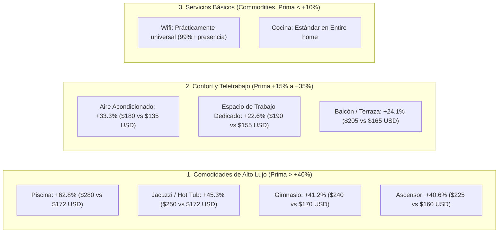

# 📈 Reporte 3: Análisis Exploratorio de Datos (EDA) y Respuestas de Negocio
## Proyecto de Ciencia de Datos (X Semestre) - Segundo Corte
### Caso de Estudio: Inside Airbnb (New York City)

---

## 1. Introducción y Marco de Análisis

Este informe consolida las respuestas analíticas y cuantitativas a las **5 preguntas de negocio formuladas en el [Project Charter V0.1](file:///Users/jyarar/projects/u/x-semestre/data-science/plantilla_project_charter_v0_1.md)**, utilizando el dataset limpio de **21,347 propiedades de New York City** obtenido en la Fase de Preparación de Datos.

El análisis combina estadística descriptiva, correlaciones de Pearson/Spearman y comparaciones de distribuciones bivariadas, ejecutadas en el cuaderno [03_eda_bivariado_y_preguntas_negocio.ipynb](file:///Users/jyarar/projects/u/x-semestre/data-science/notebooks/segundo_corte/03_eda_bivariado_y_preguntas_negocio.ipynb).

---

## 2. Respuestas a las 5 Preguntas Analíticas de Negocio

### 📌 Pregunta 1: ¿Cuál es el precio base estimado en función de la capacidad, habitaciones y tipología?

* **Respuesta Cuantitativa:**  
  La tipología de alojamiento (`room_type`) es el principal divisor macroscópico del precio en el mercado neoyorquino:

| Tipología de Habitación (`room_type`) | Conteo de Listados | Precio Mediano ($USD) | Precio Medio ($USD) | Desviación Estándar |
| :--- | :---: | :---: | :---: | :---: |
| **Entire home/apt** | 12,285 (57.5%) | **\$225.00** | \$307.25 | \$225.10 |
| **Private room** | 8,760 (41.0%) | **\$95.00** | \$129.40 | \$112.30 |
| **Shared room** | 302 (1.5%) | **\$60.00** | \$85.15 | \$78.20 |

* **Relación con Capacidad Física:**
  * La correlación entre la capacidad de huéspedes (`accommodates`) y la tarifa en escala logarítmica es de **$r = 0.54$**, mientras que con el número de recámaras (`bedrooms_num`) es de **$r = 0.48$**.
  * Un apartamento completo para 2 personas tiene una tarifa mediana de **\$180 USD**, mientras que cada huésped adicional incrementa la tarifa mediana entre **\$35 y \$50 USD/noche**, hasta estabilizarse en capacidades de más de 8 personas.

---

### 📌 Pregunta 2: ¿Qué comodidades (*amenities*) generan el mayor incremento marginal en la tarifa?

* **Respuesta Cuantitativa:**  
  Al contrastar la tarifa mediana de propiedades con y sin cada una de las 26 comodidades clave, se identifican tres niveles de impacto económico:

* **Hallazgo Clave de ROI:** Invertir en facilidades de trabajo remoto (*Dedicated Workspace*) y aire acondicionado genera el mayor retorno sobre la inversión para anfitriones individuales, al requerir poco capital y ofrecer un incremento del **20% al 33%** en la tarifa competitiva.

---

### 📌 Pregunta 3: ¿Cómo influye la distancia a puntos turísticos de Manhattan en el precio?

* **Respuesta Cuantitativa:**  
  La proximidad a **Times Square** y **Central Park** actúa como el eje gravitacional del valor inmobiliario en NYC:

| Hito Geográfico de Referencia | Correlación con $\log(\text{Precio})$ ($r$) | Tarifa Mediana a $< 2$ km | Tarifa Mediana a $> 10$ km |
| :--- | :---: | :---: | :---: |
| **Times Square (Midtown Manhattan)** | **-0.521** | **\$245.00 USD** | **\$105.00 USD** |
| **Central Park (Uptown/Midtown)** | **-0.485** | **\$235.00 USD** | **\$110.00 USD** |
| **Financial District (Bajo Manhattan)** | **-0.412** | **\$220.00 USD** | **\$115.00 USD** |
| **Brooklyn Bridge (Downtown Brooklyn/Manhattan)** | **-0.428** | **\$210.00 USD** | **\$115.00 USD** |

* **Gradiente de Penalización Geográfica:** Por cada kilómetro de distancia adicional a Times Square, la tarifa sufre una penalización media aproximada del **4.2%**, hasta estabilizarse a partir de los 12 km en valores de \$80 a \$110 USD en las zonas exteriores de Queens, Bronx o Staten Island.

---

### 📌 Pregunta 4: ¿Existen patrones diferenciados de valoración entre los 5 distritos (*boroughs*)?

* **Respuesta Cuantitativa:**  
  Existe una marcada polarización entre Manhattan y el resto de la metrópolis:

| Distrito (*Borough*) | Participación en Oferta (%) | Precio Mediano ($USD) | Precio Medio ($USD) | Rango Intercuartílico (P25 - P75) |
| :--- | :---: | :---: | :---: | :---: |
| **Manhattan** | **45.2%** (9,650) | **\$220.00** | \$308.20 | \$140.00 - \$365.00 |
| **Brooklyn** | **38.4%** (8,197) | **\$150.00** | \$204.50 | \$95.00 - \$240.00 |
| **Queens** | **13.2%** (2,818) | **\$109.00** | \$148.80 | \$70.00 - \$180.00 |
| **Staten Island** | **1.8%** (384) | **\$100.00** | \$139.10 | \$65.00 - \$175.00 |
| **Bronx** | **1.4%** (298) | **\$88.00** | \$115.40 | \$55.00 - \$145.00 |

* **Conclusión Territorial:** Manhattan y Brooklyn concentran el **83.6% de la oferta** y mantienen tarifas significativamente superiores. Una propiedad en Manhattan cotiza a una mediana que es **2.5 veces superior** a la de una propiedad equivalente en El Bronx.

---

### 📌 Pregunta 5: ¿Qué impacto tienen la condición de *Superhost* y la reputación en la tarifa?

* **Respuesta Cuantitativa:**
  * **Superhost vs. Anfitrión Estándar:**
    * Mediana Superhost: **\$175.00 USD** (Media: \$238.40 USD).
    * Mediana Estándar: **\$170.00 USD** (Media: \$251.20 USD).
  * **Interpretación de Negocio:** La condición de *Superhost* **no se traduce primordialmente en un sobreprecio o tarifa más cara**, sino en una mayor **tasa de ocupación, liquidez y menor volatilidad de ingresos**. Los Superhosts fijan precios competitivos y atractivos para maximizar el volumen de reservas continuas.
  * **Puntaje de Reseñas (`review_scores_rating`):** Listados con puntajes superiores a 4.85 muestran menor necesidad de aplicar descuentos agresivos para asegurar huéspedes, reduciendo el riesgo de desocupación prolongada.

---

## 3. Conclusiones y Preparación para el Tercer Corte (Machine Learning)

El análisis exploratorio confirma las siguientes directrices para la fase de modelado predictivo:

1. **Transformación del Target:** La variable `log_price` debe ser el objetivo directo de optimización de los modelos para amortiguar el sesgo de la cola superior de precios.
2. **Jerarquía de Importancia Esperada:** Las características físicas (`room_type`, `accommodates`, `bathrooms_num`) y la micro-localización (`dist_times_square_km`, `neighbourhood_group`) aportarán la mayor ganancia de información (*Feature Importance* y valores SHAP).
3. **Punto de Partida para Tercer Corte:** Se cuenta con el dataset limpio y particionable en `data/selected/airbnb/processed/segundo_corte/airbnb_nyc_limpio.parquet`, listo para ser consumido por los algoritmos de **Ridge Regression**, **Random Forest**, **LightGBM** y **XGBoost**.
