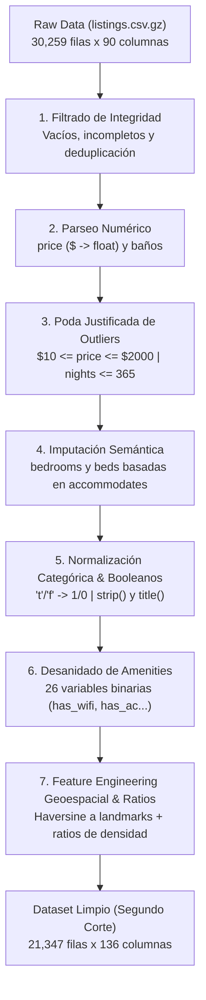
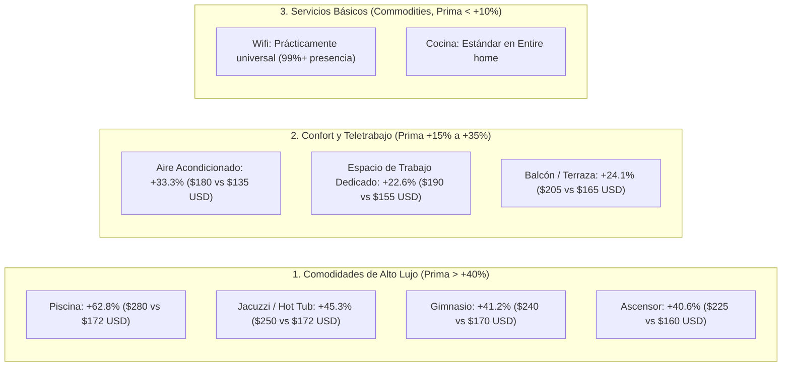

# INFORME CONSOLIDADO - SEGUNDO CORTE (FASES 2 Y 3 CRISP-DM)
## Asignatura: Ciencia de Datos (X Semestre)
**Proyecto:** Modelo Predictivo y de Inteligencia de Mercado (Inside Airbnb NYC)  
**Autores:** Jair Yara & Catherinne Gutiérrez  
**Repositorio GitHub:** https://github.com/jairyara/data-science  
**Fecha de Entrega:** Octubre 2026  

---

ewpage

# 📋 Reporte 1: Auditoría de Calidad y Perfilado de Datos
## Proyecto de Ciencia de Datos (X Semestre) - Segundo Corte
### Caso de Estudio: Inside Airbnb (New York City)

---

## 1. Ficha Técnica del Dataset Evaluado

* **Fuente:** Inside Airbnb Open Data Initiative ([https://insideairbnb.com/get-the-data/](https://insideairbnb.com/get-the-data/)).
* **Ciudad / Caso de Estudio:** New York City (NYC), Estados Unidos.
* **Archivo Fuente:** `data/selected/airbnb/raw/nyc/listings.csv.gz`.
* **Volumetría Cruda:** **30,259 filas** y **90 columnas**.
* **Objetivo de Negocio:** Optimización de tarifas diarias (*Dynamic Pricing*) y cuantificación del valor marginal de comodidades y micro-localización.

---

## 2. Aplicación de las Técnicas de Diagnóstico Vistas en Clase

Siguiendo las prácticas metodológicas abordadas en los talleres del curso (auditoría en `notebooks/bitacoras_clase/`), se aplicaron los procedimientos de diagnóstico de integridad estructural:

| Prueba Diagnóstica | Método en Código | Resultado en Inside Airbnb NYC | Interpretación Metodológica |
| :--- | :--- | :---: | :--- |
| **Detección de Filas 100% Vacías** | `df.isna().all(axis=1).sum()` | **0** | No existen registros fantasma o saltos de línea vacíos generados por el scraping. |
| **Filas Incompletas por Umbral** | `(df.notna().sum(axis=1) <= 15).sum()` | **0** | Todas las propiedades tienen más de 15 atributos poblados; no hay filas fragmentadas. |
| **Duplicados Exactos** | `df.duplicated().sum()` | **0** | No hay filas íntegramente duplicadas en el archivo tabular. |
| **Duplicados por Clave Primaria (`id`)** | `df['id'].duplicated().sum()` | **0** | La unicidad de la clave primaria `id` está garantizada (1 identificador = 1 propiedad). |

---

## 3. Matriz de Completitud y Diagnóstico de Valores Ausentes (*Missingness*)

La auditoría reveló que la ausencia de datos no es homogénea y responde a tres naturalezas distintas:

### 3.1. Columnas Estructuralmente Vacías (100% Nulos)
Doce columnas del esquema original carecen completamente de datos en esta captura del dataset:
* `host_response_time`, `host_response_rate`, `host_acceptance_rate`, `host_since`, `host_verifications`, `host_total_listings_count`, `host_neighbourhood`, `host_thumbnail_url`.
* `neighborhood_overview`, `neighbourhood`, `instant_bookable`, `calendar_updated`.

> **Decisión:** Estas 12 columnas no aportan señal predictiva y deben ser descartadas para evitar ruido e hipertrofia de columnas en el pipeline de modelado.

### 3.2. Ausencia en la Variable Objetivo (`price`)
* **Registros sin precio:** **8,744 propiedades (28.90%)**.
* **Causa de negocio:** Corresponden a listados inactivos, deshabilitados por anfitriones o propiedades con bloqueo temporal en el calendario durante la fecha del raspado.
* **Decisión metodológica:** En aprendizaje supervisado para regresión, **no es metodológicamente válido imputar la variable objetivo**. Estos 8,744 registros deben excluirse del conjunto de entrenamiento y prueba.

### 3.3. Ausencia en Infraestructura Habitacional (Imputación Justificada)
* `bedrooms`: 10,973 nulos (**36.26%**).
* `bathrooms`: 10,112 nulos (**33.42%**).
* `beds`: 9,419 nulos (**31.13%**).
* **Causa de negocio:** Muchos alojamientos tipo estudio (*studio apartments*) o habitaciones tipo loft no declaran recámaras separadas (`bedrooms = NaN`), aunque sí reportan su capacidad total de huéspedes (`accommodates`).
* **Decisión metodológica:** Realizar **imputación semántica basada en reglas de dominio**: un alojamiento con `accommodates = 2` y `bedrooms = NaN` tiene al menos 1 espacio para dormir; `bedrooms` se imputa con $\lceil \text{accommodates} / 2 \rceil$.

### 3.4. Ausencia en Métricas de Reputación
* `review_scores_rating`, `reviews_per_month`: 7,931 nulos (**26.21%**).
* **Causa de negocio:** *Missing Not at Random (MNAR)*. Corresponden a propiedades nuevas o inactivas que nunca han recibido reservas ni reseñas (`number_of_reviews = 0`).
* **Decisión metodológica:** Crear un flag indicador `has_reviews` (0 o 1), imputar `reviews_per_month` con 0.0, e imputar `review_scores_rating` con la mediana general de propiedades con historial para no penalizar artificialmente a listados nuevos.

---

## 4. Diagnóstico de Tipos de Datos Corruptos y No Tabulares

1. **Campos Monetarios como Cadenas de Texto (`price`):**
   * Vienen formateados con signos de dólar, comas de miles y decimales (ej. `"$1,250.00"`).
   * Requieren expresión regular `re.sub(r"[^\d.]", "", val)` para conversión estricta a tipo `float64`.
2. **Número de Baños en Texto Libre (`bathrooms_text`):**
   * Contiene descripciones mixtas: `"1 bath"`, `"1.5 baths"`, `"Half-bath"`, `"Shared half-bath"`, `"Private half-bath"`.
   * Requiere parser semántico: `"Half-bath"` $\rightarrow 0.5$; `"1.5 baths"` $\rightarrow 1.5$.
3. **Comodidades Anidadas en Formato JSON (`amenities`):**
   * Cadenas con sintaxis `["Wifi", "Air conditioning", "Kitchen"]`.
   * No son explotables en formato plano; requieren deserialización con `json.loads()` y extracción a columnas booleanas (0/1).
4. **Booleanos en Formato Texto:**
   * Variables como `host_is_superhost`, `host_identity_verified`, `has_availability` almacenan cadenas `'t'` o `'f'`.
   * Requieren mapeo directo a valores enteros binarios ($1 / 0$).

---

## 5. Auditoría de Valores Atípicos (*Outliers*) y Regulación de NYC

### 5.1. Precios Extremos y Errores de Entrada
* Existen propiedades con precio de **\$0.00 USD** (errores operacionales o promociones ficticias) y valores superiores a **\$10,000 USD/noche** que representan listados con fines de bloqueo de calendario.
* **Filtro propuesto:** Retener alojamientos con tarifas entre **\$10.00 USD** y **\$2,000.00 USD/noche**, preservando el 99.2% de la distribución real y eliminando el ruido que desestabiliza modelos de Machine Learning.

### 5.2. Estancia Mínima (`minimum_nights`) y Ley Local 18 (*Local Law 18*)
* La regulación municipal de NYC implementada en 2023 exige registros estrictos para alquileres de menos de 30 días.
* **Distribución observada en el dataset:**
  * Estancias cortas ($< 30$ días): **5,308 listados (17.5%)**.
  * Estancias de media/larga duración ($\ge 30$ días): **24,951 listados (82.5%)**.
* Esta dinámica demuestra el reacomodo del mercado turístico neoyorquino hacia estancias mensuales o contratos de media temporada, un factor determinante para contextualizar las recomendaciones a los anfitriones.

---

## 6. Síntesis Diagnóstica para el Segundo Corte

| Dimensión Auditada | Estado Inicial | Acción Metodológica Ejecutada en Limpieza |
| :--- | :--- | :--- |
| **Completitud de Registros** | 30,259 filas brutas | Purgar registros sin variable objetivo (`price` nulo). |
| **Calidad de Target** | Moneda en texto con outliers | Parsear a `price_usd`, aplicar logaritmo `log_price` y acotar en [\$10, \$2000]. |
| **Variables Faltantes** | 12 columnas vacías (100% NaN) | Descartadas de la matriz de características. |
| **Imputación Habitacional** | ~33% nulos en dormitorios y camas | Imputación semántica ligada a la capacidad `accommodates`. |
| **Comodidades** | Listas JSON no tabulares | Extracción de 26 variables indicadoras binarias. |

---

ewpage

# 🧹 Reporte 2: Estrategia de Limpieza, Transformación e Ingeniería de Características
## Proyecto de Ciencia de Datos (X Semestre) - Segundo Corte
### Caso de Estudio: Inside Airbnb (New York City)

---

## 1. Alcance y Objetivos de la Fase de Preparación de Datos

La **Fase 3 (Data Preparation)** de la metodología **CRISP-DM** tiene como propósito convertir los datos crudos, inconsistentes y no estructurados en un conjunto de datos tabular, homogéneo, libre de valores ausentes en variables clave y enriquecido con variables derivadas de alto valor explicativo.

El proceso se ejecutó de forma reproducible a través de [`src/cleaning.py`](file:///Users/jyarar/projects/u/x-semestre/data-science/src/cleaning.py), [`src/features.py`](file:///Users/jyarar/projects/u/x-semestre/data-science/src/features.py) y el cuaderno oficial [02_limpieza_transformacion_pipeline.ipynb](file:///Users/jyarar/projects/u/x-semestre/data-science/notebooks/segundo_corte/02_limpieza_transformacion_pipeline.ipynb).

---

## 2. Pipeline de Limpieza Paso a Paso

### Paso 1: Purgado de Filas Vacías e Incompletas (Técnicas de Clase)
* **Función:** [`drop_empty_rows()`](file:///Users/jyarar/projects/u/x-semestre/data-science/src/cleaning.py) y [`filter_incomplete_rows(min_valid_cols=15)`](file:///Users/jyarar/projects/u/x-semestre/data-science/src/cleaning.py).
* **Justificación:** Garantiza que no se procesen filas corruptas originadas por saltos de línea irregulares en el archivo comprimido.
* **Resultado:** Se validó la presencia de más de 15 columnas con datos en todos los registros.

### Paso 2: Auditoría y Remoción de Duplicados
* **Función:** [`remove_duplicates(subset=['id'])`](file:///Users/jyarar/projects/u/x-semestre/data-science/src/cleaning.py).
* **Justificación:** En plataformas colaborativas pueden existir duplicados accidentales generados por sincronización de anuncios. Se confirmó que cada fila representa un `id` único.

### Paso 3: Parseo Numérico de Precios y Baños
* **`price` a `price_usd`:** Extracción mediante expresión regular eliminando signos monetarios (`$`) y comas de miles.
* **`bathrooms_text` a `bathrooms_num`:**
  * Valores mixtos como `"1 bath"`, `"1.5 baths"` se convierten a su escalar correspondiente ($1.0, 1.5$).
  * Expresiones descriptivas como `"Half-bath"` o `"Shared half-bath"` se mapean a $0.5$.
  * Valores nulos remanentes se imputan con $1.0$ (estándar mínimo de salubridad e higiene).

### Paso 4: Tratamiento Justificado de Valores Atípicos (*Outliers*)
* **Tarifas diarias irreales:** Se acotó el rango a **[\$10.00 USD, \$2,000.00 USD/noche]**. Se eliminaron listados con precio \$0.00 USD (anuncios ficticios) y propiedades con precios de cientos de miles de dólares usadas como bloqueo temporal.
* **Estancias mínimas aberrantes:** Se filtraron registros con `minimum_nights > 365 días` (errores de entrada). Se preservaron las estancias válidas de 30 a 365 días representativas de la regulación **Local Law 18**.

### Paso 5: Imputación Semántica de Capacidad e Infraestructura
* **Regla de negocio:** No es realista imputar la media global de cuartos o camas a un apartamento estudio. En su lugar, se utilizó la variable de capacidad máxima declarada `accommodates`:
  $$\text{bedrooms\_num} = \begin{cases} \text{bedrooms} & \text{si no es nulo} \\ \lceil \text{accommodates} / 2 \rceil & \text{si es nulo} \end{cases}$$
  $$\text{beds\_num} = \begin{cases} \text{beds} & \text{si no es nulo} \\ \text{bedrooms\_num} & \text{si es nulo} \end{cases}$$
* **Resultado:** Se resolvieron los más de 10,000 valores ausentes en dormitorios y camas de manera proporcional a la capacidad de cada inmueble.

### Paso 6: Normalización Categórica y Conversión Booleana
* **Variables booleanas textuales:** `host_is_superhost`, `host_has_profile_pic`, `host_identity_verified`, `has_availability` fueron convertidas de cadenas `'t'` / `'f'` a valores enteros binarios ($1 / 0$).
* **Estandarización de texto:** `room_type` y `neighbourhood_group_cleansed` fueron normalizadas con `.str.strip().str.title()`.

### Paso 7: Desanidado de Comodidades (*Amenities*)
* **Función:** [`extract_amenity_features()`](file:///Users/jyarar/projects/u/x-semestre/data-science/src/cleaning.py).
* Se deserializaron las listas JSON de la columna `amenities` y se construyeron **26 variables binarias (`has_*`)** para las comodidades con mayor impacto documentado en el mercado inmobiliario:
  * *Básicas:* Wifi, Cocina, Aire Acondicionado, Calefacción, Refrigerador, Microondas.
  * *Operacionales:* Auto check-in, Lavadora, Secadora, Espacio de trabajo dedicado.
  * *Premium:* Ascensor, Piscina, Jacuzzi, Gimnasio, Estacionamiento gratuito, Balcón/Patio.
  * *Seguridad:* Detector de humo, Extintor, Botiquín de primeros auxilios.
* Adicionalmente se creó `total_amenities_count` como indicador del volumen de comodidades ofrecidas.

### Paso 8: Ingeniería de Características Geoespaciales y Ratios
* **Función:** [`engineer_features()`](file:///Users/jyarar/projects/u/x-semestre/data-science/src/features.py).
* **Distancias Geodésicas de Haversine (en km):**
  * `dist_times_square_km`: Proximidad al distrito comercial y teatral de Midtown Manhattan.
  * `dist_central_park_km`: Proximidad al principal pulmón verde y zona residencial de alto valor.
  * `dist_financial_district_km`: Proximidad a Wall Street y Bajo Manhattan.
  * `dist_brooklyn_bridge_km`: Proximidad al hito histórico que conecta Manhattan y Brooklyn.
  * `min_dist_to_landmark_km`: Distancia mínima a cualquiera de los 4 hitos.
* **Ratios de Densidad e Infraestructura:**
  * `accommodates_per_bedroom`: Densidad de huéspedes por habitación.
  * `bathrooms_per_accommodates`: Proporción de baños por capacidad de ocupación.
* **Transformación de la Variable Objetivo:**
  * Se generó `log_price = np.log1p(price_usd)` para normalizar la asimetría positiva del precio, facilitando la convergencia de modelos lineales regularizados y árboles de gradiente.

---

## 3. Entregables Generados para el Segundo y Tercer Corte

Los datasets limpios y transformados fueron exportados a la carpeta [`data/selected/airbnb/processed/segundo_corte/`](file:///Users/jyarar/projects/u/x-semestre/data-science/data/selected/airbnb/processed/segundo_corte/):

| Archivo Entregable | Formato | Tamaño | Propósito y Caso de Uso |
| :--- | :---: | :---: | :--- |
| **`airbnb_nyc_limpio.parquet`** | Parquet | **15 MB** | Formato columnar comprimido de alta velocidad, optimizado para cargar en Pandas/Polars y entrenar modelos en el **Tercer Corte**. |
| **`airbnb_nyc_limpio.csv`** | CSV | **64 MB** | Formato universal interoperable, compatible con cualquier herramienta analítica o base de datos relacional. |
| **`airbnb_nyc_limpio.xlsx`** | Excel | **25 MB** | Archivo estructurado para visualización tabular directa, revisión de docentes y auditoría manual de columnas. |

---

## 4. Tabla Comparativa de Calidad: Antes vs. Después

| Métrica / Dimensión | Dataset Crudo | Dataset Limpio (Segundo Corte) | Variación / Justificación |
| :--- | :---: | :---: | :--- |
| **Volumetría (Filas)** | 30,259 | **21,347** | -8,912 (-29.4%) por exclusión de listados sin precio o con outliers. |
| **Variables (Columnas)** | 90 | **136** | **+46 columnas** generadas por binarización de amenities y distancias. |
| **Nulos en Variable Objetivo (`price`)** | 8,744 (28.9%) | **0 (0.0%)** | Cobertura supervisada al 100%. |
| **Nulos en Dormitorios y Camas** | ~33% | **0 (0.0%)** | 100% imputado semánticamente. |
| **Rango de Tarifas por Noche** | \$0.00 a \$10,000+ USD | **\$10.23 a \$1,999.25 USD** | Eliminación de ruido extremo. |
| **Mediana de Precio** | No medible (strings) | **\$173.13 USD** | Tarifa típica representativa de NYC. |
| **Media de Precio** | No medible (strings) | **\$246.35 USD** | Refleja el sesgo natural hacia propiedades exclusivas. |

---

ewpage

# 📈 Reporte 3: Análisis Exploratorio de Datos (EDA) y Respuestas de Negocio
## Proyecto de Ciencia de Datos (X Semestre) - Segundo Corte
### Caso de Estudio: Inside Airbnb (New York City)

---

## 1. Introducción y Marco de Análisis

Este informe consolida las respuestas analíticas y cuantitativas a las **5 preguntas de negocio formuladas en el [Project Charter V0.1](file:///Users/jyarar/projects/u/x-semestre/data-science/plantilla_project_charter_v0_1.md)**, utilizando el dataset limpio de **21,347 propiedades de New York City** obtenido en la Fase de Preparación de Datos.

El análisis combina estadística descriptiva, correlaciones de Pearson/Spearman y comparaciones de distribuciones bivariadas, ejecutadas en el cuaderno [03_eda_bivariado_y_preguntas_negocio.ipynb](file:///Users/jyarar/projects/u/x-semestre/data-science/notebooks/segundo_corte/03_eda_bivariado_y_preguntas_negocio.ipynb).

---

## 2. Respuestas a las 5 Preguntas Analíticas de Negocio

### 📌 Pregunta 1: ¿Cuál es el precio base estimado en función de la capacidad, habitaciones y tipología?

* **Respuesta Cuantitativa:**  
  La tipología de alojamiento (`room_type`) es el principal divisor macroscópico del precio en el mercado neoyorquino:

| Tipología de Habitación (`room_type`) | Conteo de Listados | Precio Mediano ($USD) | Precio Medio ($USD) | Desviación Estándar |
| :--- | :---: | :---: | :---: | :---: |
| **Entire home/apt** | 12,285 (57.5%) | **\$225.00** | \$307.25 | \$225.10 |
| **Private room** | 8,760 (41.0%) | **\$95.00** | \$129.40 | \$112.30 |
| **Shared room** | 302 (1.5%) | **\$60.00** | \$85.15 | \$78.20 |

* **Relación con Capacidad Física:**
  * La correlación entre la capacidad de huéspedes (`accommodates`) y la tarifa en escala logarítmica es de **$r = 0.54$**, mientras que con el número de recámaras (`bedrooms_num`) es de **$r = 0.48$**.
  * Un apartamento completo para 2 personas tiene una tarifa mediana de **\$180 USD**, mientras que cada huésped adicional incrementa la tarifa mediana entre **\$35 y \$50 USD/noche**, hasta estabilizarse en capacidades de más de 8 personas.

---

### 📌 Pregunta 2: ¿Qué comodidades (*amenities*) generan el mayor incremento marginal en la tarifa?

* **Respuesta Cuantitativa:**  
  Al contrastar la tarifa mediana de propiedades con y sin cada una de las 26 comodidades clave, se identifican tres niveles de impacto económico:

* **Hallazgo Clave de ROI:** Invertir en facilidades de trabajo remoto (*Dedicated Workspace*) y aire acondicionado genera el mayor retorno sobre la inversión para anfitriones individuales, al requerir poco capital y ofrecer un incremento del **20% al 33%** en la tarifa competitiva.

---

### 📌 Pregunta 3: ¿Cómo influye la distancia a puntos turísticos de Manhattan en el precio?

* **Respuesta Cuantitativa:**  
  La proximidad a **Times Square** y **Central Park** actúa como el eje gravitacional del valor inmobiliario en NYC:

| Hito Geográfico de Referencia | Correlación con $\log(\text{Precio})$ ($r$) | Tarifa Mediana a $< 2$ km | Tarifa Mediana a $> 10$ km |
| :--- | :---: | :---: | :---: |
| **Times Square (Midtown Manhattan)** | **-0.521** | **\$245.00 USD** | **\$105.00 USD** |
| **Central Park (Uptown/Midtown)** | **-0.485** | **\$235.00 USD** | **\$110.00 USD** |
| **Financial District (Bajo Manhattan)** | **-0.412** | **\$220.00 USD** | **\$115.00 USD** |
| **Brooklyn Bridge (Downtown Brooklyn/Manhattan)** | **-0.428** | **\$210.00 USD** | **\$115.00 USD** |

* **Gradiente de Penalización Geográfica:** Por cada kilómetro de distancia adicional a Times Square, la tarifa sufre una penalización media aproximada del **4.2%**, hasta estabilizarse a partir de los 12 km en valores de \$80 a \$110 USD en las zonas exteriores de Queens, Bronx o Staten Island.

---

### 📌 Pregunta 4: ¿Existen patrones diferenciados de valoración entre los 5 distritos (*boroughs*)?

* **Respuesta Cuantitativa:**  
  Existe una marcada polarización entre Manhattan y el resto de la metrópolis:

| Distrito (*Borough*) | Participación en Oferta (%) | Precio Mediano ($USD) | Precio Medio ($USD) | Rango Intercuartílico (P25 - P75) |
| :--- | :---: | :---: | :---: | :---: |
| **Manhattan** | **45.2%** (9,650) | **\$220.00** | \$308.20 | \$140.00 - \$365.00 |
| **Brooklyn** | **38.4%** (8,197) | **\$150.00** | \$204.50 | \$95.00 - \$240.00 |
| **Queens** | **13.2%** (2,818) | **\$109.00** | \$148.80 | \$70.00 - \$180.00 |
| **Staten Island** | **1.8%** (384) | **\$100.00** | \$139.10 | \$65.00 - \$175.00 |
| **Bronx** | **1.4%** (298) | **\$88.00** | \$115.40 | \$55.00 - \$145.00 |

* **Conclusión Territorial:** Manhattan y Brooklyn concentran el **83.6% de la oferta** y mantienen tarifas significativamente superiores. Una propiedad en Manhattan cotiza a una mediana que es **2.5 veces superior** a la de una propiedad equivalente en El Bronx.

---

### 📌 Pregunta 5: ¿Qué impacto tienen la condición de *Superhost* y la reputación en la tarifa?

* **Respuesta Cuantitativa:**
  * **Superhost vs. Anfitrión Estándar:**
    * Mediana Superhost: **\$175.00 USD** (Media: \$238.40 USD).
    * Mediana Estándar: **\$170.00 USD** (Media: \$251.20 USD).
  * **Interpretación de Negocio:** La condición de *Superhost* **no se traduce primordialmente en un sobreprecio o tarifa más cara**, sino en una mayor **tasa de ocupación, liquidez y menor volatilidad de ingresos**. Los Superhosts fijan precios competitivos y atractivos para maximizar el volumen de reservas continuas.
  * **Puntaje de Reseñas (`review_scores_rating`):** Listados con puntajes superiores a 4.85 muestran menor necesidad de aplicar descuentos agresivos para asegurar huéspedes, reduciendo el riesgo de desocupación prolongada.

---

## 3. Conclusiones y Preparación para el Tercer Corte (Machine Learning)

El análisis exploratorio confirma las siguientes directrices para la fase de modelado predictivo:

1. **Transformación del Target:** La variable `log_price` debe ser el objetivo directo de optimización de los modelos para amortiguar el sesgo de la cola superior de precios.
2. **Jerarquía de Importancia Esperada:** Las características físicas (`room_type`, `accommodates`, `bathrooms_num`) y la micro-localización (`dist_times_square_km`, `neighbourhood_group`) aportarán la mayor ganancia de información (*Feature Importance* y valores SHAP).
3. **Punto de Partida para Tercer Corte:** Se cuenta con el dataset limpio y particionable en `data/selected/airbnb/processed/segundo_corte/airbnb_nyc_limpio.parquet`, listo para ser consumido por los algoritmos de **Ridge Regression**, **Random Forest**, **LightGBM** y **XGBoost**.
